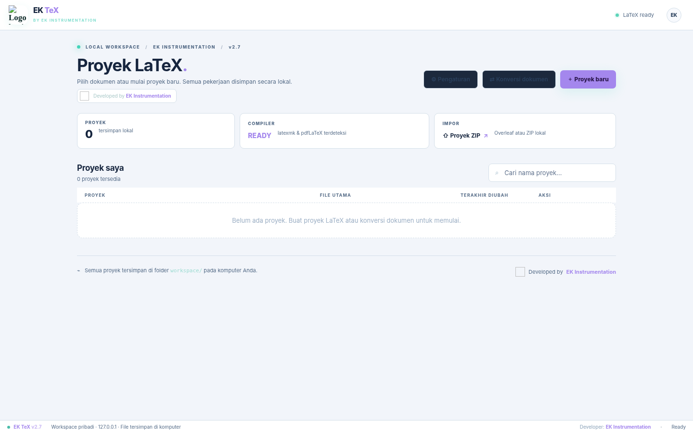
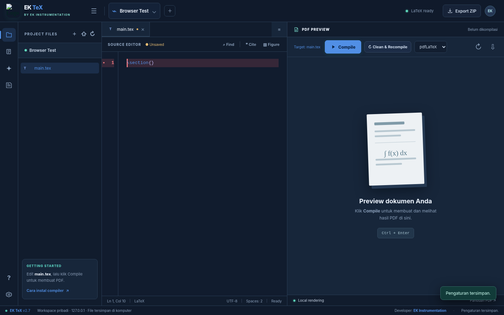

<p align="center">
  
</p>

<h1 align="center">EK TeX</h1>
<p align="center"><strong>Local LaTeX Workspace</strong> · Research Editor · PDF Compiler · Bibliography Tools</p>
<p align="center">
  <a href="https://ek-instrumentation.com">🌐 EK Instrumentation — Official Website</a> &nbsp;·&nbsp;
  <a href="https://github.com/efendiyhy/ek-tex">Source Repository</a> &nbsp;·&nbsp;
  <a href="CHANGELOG.md">Release Notes</a>
</p>

**EK TeX** merupakan editor LaTeX berbasis browser yang berjalan pada komputer pengguna. Aplikasi menyediakan dashboard proyek, editor multi-file, kompilasi dan pratinjau PDF, diagnostik LaTeX, pengelolaan BibTeX, integrasi Hermes Agent opsional, dan konversi dokumen melalui Pandoc.

Dokumen proyek disimpan secara lokal di direktori `workspace/`. Akses internet diperlukan untuk pencarian metadata referensi, instalasi dependensi, atau layanan model AI eksternal yang digunakan melalui Hermes.



<sub>Contoh tampilan dashboard. Tampilan editor dan pengaturan dapat berubah mengikuti tema serta ukuran layar.</sub>

## Contents

- [Features](#features)
- [Requirements](#requirements)
- [Installation](#installation)
- [Updating EK TeX](#updating-ek-tex)
- [Reference Discovery](#reference-discovery)
- [AI-assisted Reference Keywords](#ai-assisted-reference-keywords)
- [Editing and Compiling](#editing-and-compiling)
- [Keyboard Shortcuts](#keyboard-shortcuts)
- [Troubleshooting](#troubleshooting)
- [Privacy and Limitations](#privacy-and-limitations)
- [Developer](#developer)

## Features

| Module | Capabilities |
|---|---|
| Workspace | Dashboard daftar proyek, create/rename/delete, import/export ZIP |
| Source editor | Syntax highlighting, autosave, multi-tab, LaTeX autocomplete, error-line highlighting, minimizable sidebar |
| PDF compiler | pdfLaTeX, XeLaTeX, LuaLaTeX via `latexmk`; active-file compilation, PDF preview, Clean & Recompile, live log, Stop |
| Bibliography | **Dedicated reference popup** with title, author and DOI search; BibTeX metadata from Crossref |
| Contextual reference lookup | Highlight a sentence → **Cari Referensi** → editable keyword extraction → search and optionally insert `\cite{key}` |
| Optional Hermes integration | Keyword suggestions and source-code diagnostics when Hermes Agent has been installed and configured |
| Document conversion | DOCX, ODT, Markdown and HTML conversions through Pandoc; converted LaTeX becomes a separate project |
| Appearance | Emerald, Ocean Blue, Amethyst, Copper; light and dark modes saved in the browser |



## Requirements

- **Windows 10/11:** PowerShell, WinGet and internet for initial setup. Installer can prepare Node.js, MiKTeX, Perl and `latexmk`.
- **Ubuntu / Debian:** Git, Node.js, TeX Live, `latexmk` and required TeX packages. Use the provided setup script.
- **Optional:** Pandoc for conversions; Hermes Agent for AI-assisted features. EK TeX does **not** bundle an AI model or an account.

## Installation

### Windows

Download or clone the repository, then run `install-windows.bat` from the extracted project folder. The installer targets `Documents\EK-TeX`, prepares dependencies and creates shortcuts in the Desktop/Start Menu. Launching the shortcut opens a visible terminal for the local server. Press **Ctrl+C** in that terminal to stop EK TeX.

To run directly from source without installing a shortcut, use `start-windows.bat`.

### Ubuntu / Debian

```bash
sudo apt update
sudo apt install -y git
mkdir -p ~/Documents
cd ~/Documents
git clone https://github.com/efendiyhy/ek-tex.git EK-TeX
cd EK-TeX
chmod +x setup-linux.sh start-linux.sh update-linux.sh
./setup-linux.sh --yes
./start-linux.sh
```

Open **http://127.0.0.1:3457**. Press **Ctrl+C** to stop the foreground server. Port `3457` is bound to loopback only.

## Updating EK TeX

**Stop the EK TeX terminal/server before any update.** Local documents under `workspace/` are not tracked by Git, but back up important projects regularly.

**Ubuntu — installation from GitHub:**

```bash
cd ~/Documents/EK-TeX
./update-linux.sh
./start-linux.sh
```

The updater uses `git pull --ff-only origin main` and stops if tracked source files contain uncommitted changes. Alternatively run the Git command manually.

**Windows:** Close the server, run `update-windows.cmd` from `Documents\EK-TeX`, and reopen the app from the desktop shortcut.

**Manual ZIP update:** Extract the *Update Only* archive over the source code and replace matching files. **Do not replace `workspace/` or project data.** If the browser still shows old styles, press `Ctrl+Shift+R`.

## Reference Discovery

Access **Cari Referensi** from the dashboard, editor toolbar, or references icon in the editor rail. The search opens in a **dedicated popup** with independent fields:

1. **Article title:** Searches Crossref bibliographic metadata. Partial titles are supported.
2. **Author:** Filters Crossref results by author. Can be combined with title.
3. **DOI:** Fetches a publication directly when its DOI is known.

The popup does **not** close when clicking outside or pressing Escape. Only the **X** button closes it, including during a pending search. A source result can be saved to the active project's `references.bib`; duplicate DOI checks prevent repeated imports. When opened from the dashboard without a project, searching is possible, but saving requires opening a project.

The publication title, author list, venue, year, and DOI come from the provider metadata. **No citation is fabricated by the AI.** Check every publication before relying on it for an academic claim.

## AI-assisted Reference Keywords

Within an open `.tex` file, **highlight a sentence** (12–1700 characters). A floating **Cari Referensi** action appears near the selected text. Clicking it opens the reference popup with the selected passage and study title (from `\title{...}`, or the project name when unavailable).

The application attempts to generate focused keywords via the locally installed Hermes CLI in non-interactive mode. It provides Hermes with **only the selected passage and title**, not the entire document. The suggestions and search query remain editable. If Hermes is unavailable or fails, the app provides a **local keyword fallback** without any online AI service. Actual publication search still requires network access to Crossref.

After inspecting results, choose **Simpan ke BibTeX** or **Simpan & kutip**. The second action inserts `\cite{key}` immediately after the original selected passage only if the file, project and selected text are unchanged. If context has changed, the citation is **not** inserted automatically.

> **Research integrity:** Keyword extraction is only a discovery aid. A matching title does not prove that a paper supports the highlighted sentence. Verify abstracts, methods and results manually. A Hermes provider configured to use remote models may transmit the selected text to that provider.

## Editing and Compiling

1. Open a project and select a `.tex` file from the file tree.
2. Write LaTeX; typing `\` opens autocomplete. Use arrows and Enter/Tab to insert suggestions.
3. Select a compiler (pdfLaTeX / XeLaTeX / LuaLaTeX) and click **Compile** or press `Ctrl+Enter`. The **active `.tex` file** is the compilation target.
4. Inspect the PDF preview or compiler output. Clicking a line-numbered error opens the relevant source and highlights its line.
5. Use **Clean & Recompile** after corrections to remove build cache (not source files).

For `\include{Isi/Bab1}`, the application prepares corresponding subdirectories under `.latexstudio-build` before compilation. Individual chapter fragments without a preamble cannot always be compiled as standalone documents.

## Keyboard Shortcuts

| Shortcut | Action |
|---|---|
| `Ctrl+S` | Save source files |
| `Ctrl+Enter` | Compile current `.tex` file |
| `Ctrl+B` | Collapse / expand sidebar |
| `Ctrl+F` | Find in open source file |
| `\` | LaTeX command suggestions |
| `↑` / `↓`, `Enter` / `Tab` | Navigate and accept suggestions |
| `Escape` | Close standard dialogs and autocomplete (**not** the reference search popup) |

## Troubleshooting

**Missing `.sty`:** Install the relevant TeX package, e.g. `sudo apt install texlive-science` for `algorithmic.sty` on Ubuntu. **Previous invocation of latexmk failed:** Use Clean & Recompile; inspect the first real error in Output. **Styles not loading:** Access `http://127.0.0.1:3457`, verify the `public/` assets exist, restart the server, and reload without browser cache. **Hermes unavailable:** Install/configure it separately, or edit the automatically generated offline keywords.

To run the automated project tests:

```bash
node --check server.js
node --check public/app.js
node --check public/reference-ui.js
npm test
```

## Privacy and Limitations

- Server listens on `127.0.0.1` and stores projects locally. Do not expose the service publicly without additional authentication and network safeguards.
- The reference popup queries Crossref over HTTPS. Internet access is needed; Crossref availability and metadata coverage may vary.
- AI-assisted keywords use the machine's existing Hermes configuration; remote providers, when configured, have their own privacy policies.
- Manual review is required before citing a source. Bibliography metadata can be incomplete or inaccurate.
- DOCX → LaTeX conversion may need editing for equations, tables, cross-references, and images.

## Developer

<p> <strong>EK Instrumentation</strong> — Instrumentation, software and research solutions.</p>

**Official website:** [ek-instrumentation.com](https://ek-instrumentation.com)  
**GitHub:** [efendiyhy/ek-tex](https://github.com/efendiyhy/ek-tex)  
**Release:** 2.8.0
