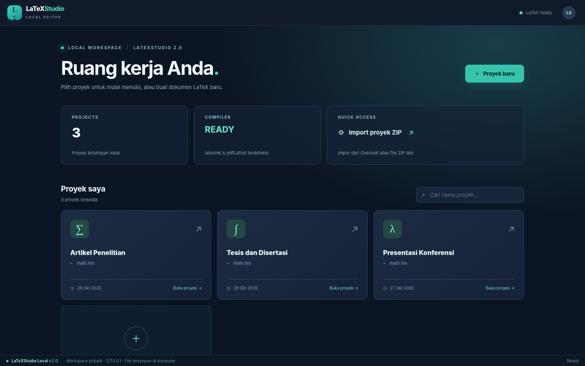

# LaTeXStudio Local v2.1

**Local LaTeX editor** seperti alur kerja Overleaf: dashboard proyek → editor `.tex` → kompilasi PDF dan preview, dengan file manager dan referensi DOI. Semua proyek disimpan lokal di folder `workspace/`. Aplikasi tidak terafiliasi dengan Overleaf atau OpenAI Prism.



## Windows — cara termudah

1. Klik **Code → Download ZIP** di halaman repo GitHub.
2. Ekstrak file ZIP ke direktori **yang permanen** (mis. `C:\LaTeXStudio`). Jangan jalankan langsung dari ZIP atau folder Downloads yang nantinya akan dipindah/hapus.
3. Klik **`install-windows.bat`**. Saat diminta, setujui pemasangan komponen yang belum tersedia via WinGet: **Node.js LTS, MiKTeX, Strawberry Perl, latexmk**. Instalasi pertama **memerlukan internet, WinGet (App Installer), ruang disk, dan mungkin izin administrator**.
4. Installer memverifikasi kompilasi PDF dan membuat shortcut **LaTeXStudio Local** di **Desktop** dan **Start Menu**.
5. Klik shortcut. Browser membuka `http://127.0.0.1:3457`, dan **terminal server tetap terbuka**.
6. Untuk stop: di terminal tekan **Ctrl+C** (jika Windows bertanya *Terminate batch job (Y/N)?*, pilih **Y**), atau tutup terminal. Jika proses berakhir, terminal menampilkan hasilnya lalu bisa ditutup.

**Penting:** Jika lokasi folder aplikasi dipindah, shortcut lama tidak valid. Jalankan `install-windows.bat` lagi dari lokasi baru untuk memperbarui shortcut.

### Instalasi langsung dari GitHub (tanpa menginstal Git)

Untuk **repository PUBLIC** yang sudah Anda push, buka **Windows PowerShell** pada laptop lain dan jalankan (ganti `USERNAME/LaTeXStudio-Local` dengan repo Anda):

```powershell
$repo = 'USERNAME/LaTeXStudio-Local'
$installer = Join-Path $env:TEMP 'install-latexstudio.ps1'
Invoke-WebRequest "https://raw.githubusercontent.com/$repo/main/install-from-github.ps1" -OutFile $installer
powershell -NoProfile -ExecutionPolicy Bypass -File $installer -Repository $repo
```

Script mengunduh arsip branch `main` dari GitHub, mengekstrak kode ke `%LOCALAPPDATA%\Programs\LaTeXStudioLocal`, menjalankan installer dependensi, kemudian membuat shortcut. **Tidak perlu Git**. Untuk repo private atau jaringan yang memblokir GitHub, gunakan ZIP manual. Anda dianjurkan membaca script sebelum menjalankannya karena ia mengunduh dan menginstal aplikasi.

**Update di laptop yang telah diinstal melalui GitHub:** tutup terminal server, lalu klik `update-windows.cmd` di folder aplikasi. Script mengambil source terbaru dan **tidak menghapus `workspace/`**. Shortcut tetap berfungsi. Jika instalasi lama dari ZIP, update manual bisa dilakukan dengan ekstraksi versi baru dan memindahkan `workspace/` secara aman.

> Installer tidak membuat Windows Service, scheduled task, atau autostart. Server hanya hidup selama terminal aplikasi berjalan dan hanya listen di `127.0.0.1` (bukan akses publik LAN).

## Push pertama ke GitHub

Lihat panduan lengkap **[PUSH-KE-GITHUB.md](PUSH-KE-GITHUB.md)**. Ringkasnya, setelah membuat repository baru **kosong** di GitHub:

```powershell
cd C:\LaTeXStudio

git init
git add .
git commit -m "LaTeXStudio Local v2.1 - installer and shortcuts"
git branch -M main
git remote add origin https://github.com/USERNAME/LaTeXStudio-Local.git
git push -u origin main
```

**Jangan push isi folder `workspace/`** (proyek pribadi), `.latexstudio-build`, log dan data instalasi. `.gitignore` sudah disertakan. Pastikan GitHub repo bukan berisi data privat sebelum dijadikan public.

## Fitur utama

- Dashboard daftar proyek → klik salah satu proyek untuk masuk editor.
- Editor syntax highlight dan multi-file `.tex`, `.bib`, `.sty`, `.cls` serta upload gambar.
- Compile pdfLaTeX, XeLaTeX, LuaLaTeX melalui `latexmk`; preview dan unduh PDF.
- Sidebar dapat disembunyikan dengan tombol atau **Ctrl+B**.
- Cari literatur di Crossref, impor DOI ke `.bib` dan perbarui metadata DOI online.
- Autosave, backup lokal, import/export proyek ZIP.
- **Ctrl+S** untuk save, **Ctrl+Enter** untuk compile.

## Linux Ubuntu / Debian / Armbian

```bash
chmod +x start-linux.sh setup-linux.sh
./start-linux.sh
```

Launcher memasang Node.js, TeX Live, `latexmk` jika belum tersedia (menggunakan `apt` dan mungkin `sudo`), menguji compiler, lalu menjalankan server. Proyek tetap disimpan di `workspace/`. Shortcut Desktop otomatis saat ini khusus Windows.

## Persyaratan dan catatan

- **Node.js 18+**, versi 20/22 LTS direkomendasikan. Tidak ada dependensi npm eksternal.
- Kompilasi PDF membutuhkan distribusi LaTeX dan `latexmk`. Paket berukuran besar **tidak dibundel** dalam GitHub repo.
- Instalasi pertama memakai internet; pengeditan dan kompilasi yang sudah terpasang bisa berjalan offline. Pencarian DOI/paket LaTeX baru tetap membutuhkan internet.
- Source LaTeX yang tidak tepercaya berisiko. Backend menggunakan `-no-shell-escape` dan bind localhost saja, tetapi jangan membuka proyek asing tanpa pemeriksaan.
- Untuk kode editor dan server, jalankan `npm test` (smoke test Node.js). Untuk uji compiler jalankan `npm run verify-latex`.
- Setup WinGet dan shortcut **belum dieksekusi pada Windows** di lingkungan pengujian ini; uji pada laptop Windows sebelum menyebarkan secara luas.

## Struktur file

| File / Folder | Fungsi |
|---|---|
| `server.js`, `public/` | Backend dan antarmuka editor |
| `workspace/` | **Dokumen pengguna**, tidak dipush ke GitHub |
| `install-windows.bat` / `.ps1` | Instal dependensi + shortcut Desktop dan Start Menu |
| `run-windows.cmd` / `.ps1` | Menjalankan server di **terminal yang terlihat** |
| `install-from-github.ps1` | Install/update lewat GitHub tanpa Git |
| `update-windows.cmd` | Update instalasi GitHub dengan menjaga workspace |
| `start-windows.bat` | Launcher lama yang memeriksa dependensi dulu |
| `setup-windows.ps1` | WinGet, MiKTeX, Perl, latexmk, uji compiler |
| `tests/smoke.js` | Pengujian API terisolasi |

Lihat pula [INSTALL-DI-LAPTOP-LAIN.md](INSTALL-DI-LAPTOP-LAIN.md) untuk langkah instalasi, mengatasi masalah PATH/WinGet, dan cara backup data.
